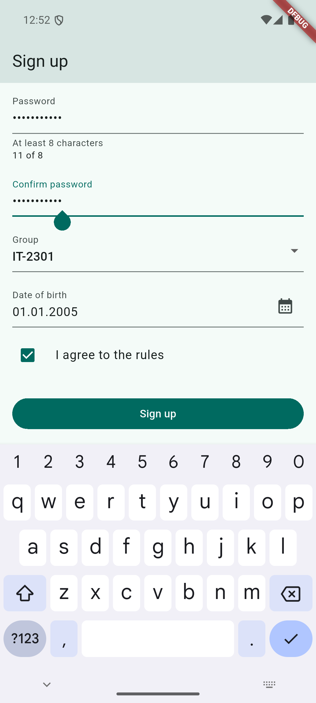
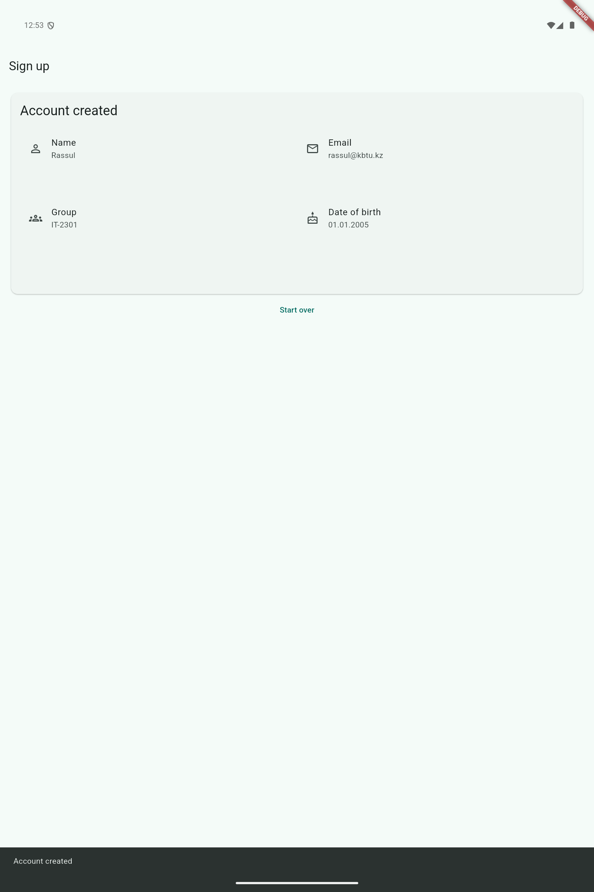

# Practice 7 — A Form That Validates Itself

A sign-up form with name, email, password confirmation, group, date of birth and agreement. Data stays in memory. This example does not create a server account or store a password.

## Run

Open this folder in Android Studio, select an Android device and run `lib/main.dart`, or use:

```sh
flutter pub get
flutter run -d emulator-5554
```

## Structure

- `lib/main.dart`: form state, controllers, focus, validation, date picker and reset.
- `lib/summary_card.dart`: a separate, immutable summary widget. Its own width selects one or two columns at 600 logical pixels.
- `test/widget_test.dart`: agreement gating, invalid and valid submission, date cancellation, full reset and responsive summary.
- `test_driver/`: an Android smoke scenario and screenshots; `flutter_driver` is a development-only Flutter SDK dependency.

Controllers, the form key and the email FocusNode belong to State. All disposable objects are disposed. The button runs one `validate()`; field validators provide messages. The agreement enables the button through its nullable callback. Keyboard Done submits only while agreement is enabled. Cancel in the date picker keeps the old date. Start over clears every value without reading the removed Form's state.

## Verify and build

```sh
dart format .
flutter analyze
flutter test
flutter build apk --release --target=lib/main.dart
```

The APK is generated at `build/app/outputs/flutter-apk/app-release.apk`.

For the device smoke test, start one Android emulator with ID `emulator-5554`, then run:

```sh
flutter drive --driver=test_driver/smoke.dart --target=test_driver/app.dart -d emulator-5554
```

The host-side test uses the Android SDK at `~/Library/Android/sdk`. It temporarily changes the emulator resolution and density for the tablet screenshot and restores them in `finally`. The screenshot data is synthetic.

## Screenshots

Form with the keyboard on Confirm password:



Summary at tablet width:


