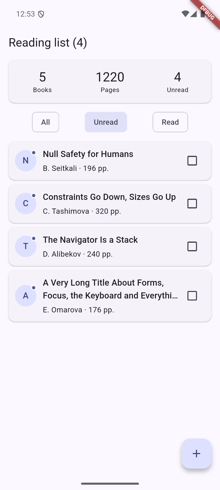
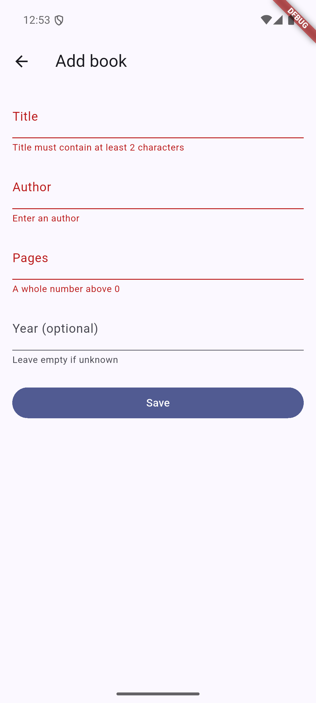

# Practice 8 — A Little of Everything

An in-memory reading list. Filter books by read status, toggle a checkbox, open details, confirm deletion or add a book through a validated form. Restarting the app restores the seed data.

## Run

Open this folder in Android Studio, select an Android device and run `lib/main.dart`, or use:

```sh
flutter pub get
flutter run -d emulator-5554
```

Startup prints `1220 pages, 4 unread` and `X — Y, 10 pp.`.

## Structure

- `lib/models/book.dart`: plain Dart model, `fromMap`, nullable year, collection helpers and seed data. Each access to `seed` provides independent books.
- `lib/main.dart`: startup output, app theme and initial screen.
- `lib/library_screen.dart`: list and filter state, derived statistics and navigation results.
- `lib/widgets/book_tile.dart`: reusable themed card, title ellipsis, unread dot and callback-driven checkbox.
- `lib/detail_screen.dart`: displays a Book and returns a BookAction; deletion requires confirmation.
- `lib/add_book_screen.dart`: validates input and returns a Book. An empty year becomes null.

The list owns mutations. Detail and form screens return decisions through Navigator; callers check mounted and null before updating state. Controllers live in State and are disposed. The filter uses an enum and an exhaustive switch expression. BookTile takes its colours and text styles from the theme.

## Verify and build

```sh
dart format .
flutter analyze
flutter test
flutter build apk --release --target=lib/main.dart
```

The APK is generated at `build/app/outputs/flutter-apk/app-release.apk`.

Tests cover model conversion, collection totals, seed isolation, live filtering, navigation, cancelled deletion, adding a book without a year, validation and narrow portrait/landscape layouts.

For the device smoke test, start an Android emulator with ID `emulator-5554`, then run:

```sh
flutter drive --driver=test_driver/smoke.dart --target=test_driver/app.dart -d emulator-5554
```

The screenshot test uses the Android SDK at `~/Library/Android/sdk`. `flutter_driver` is a development-only dependency from the Flutter SDK; it is not part of the normal app entrypoint.

## Screenshots

Unread filter and wrapped long title:



Empty form showing three validation errors:


