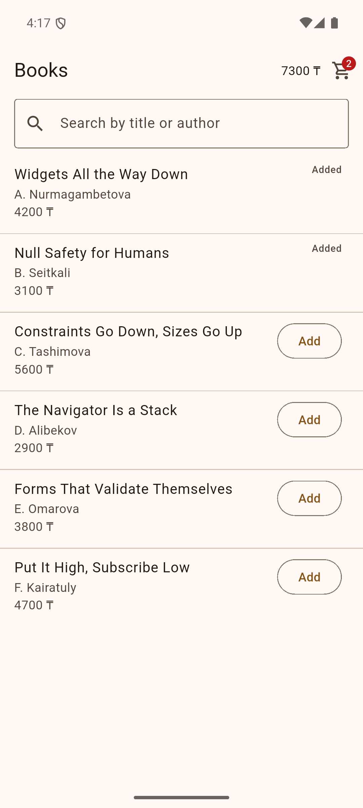
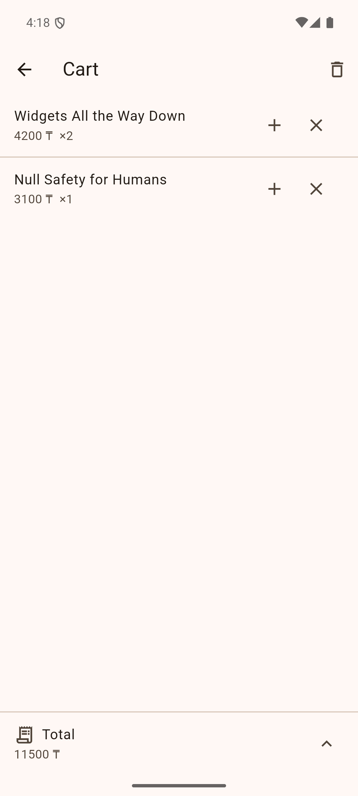

# Shop
A Flutter bookstore for Practice 9. Open this directory in Android Studio, select an Android emulator and run lib/main.dart.

Add two books, open the cart and press +. The number on the cart badge counts distinct titles; the total counts every copy. Search filters the catalogue without changing the cart. The cart lives in memory and starts empty on a fresh launch.

Run `flutter test` to verify cart rules, cross-route updates and the clear confirmation. See [NOTES.md](NOTES.md) for the measured rebuild counts and the earlier lifted implementation.

