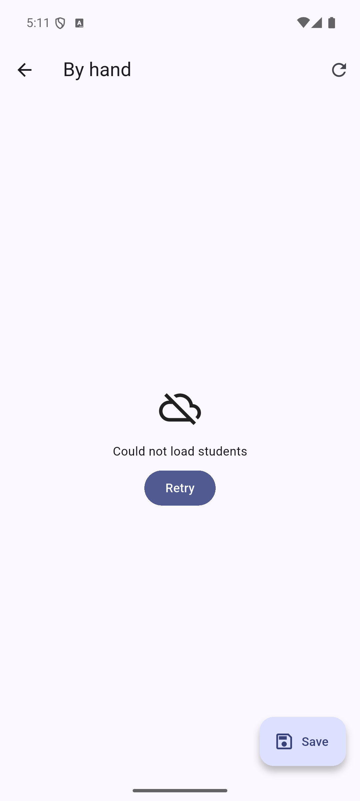
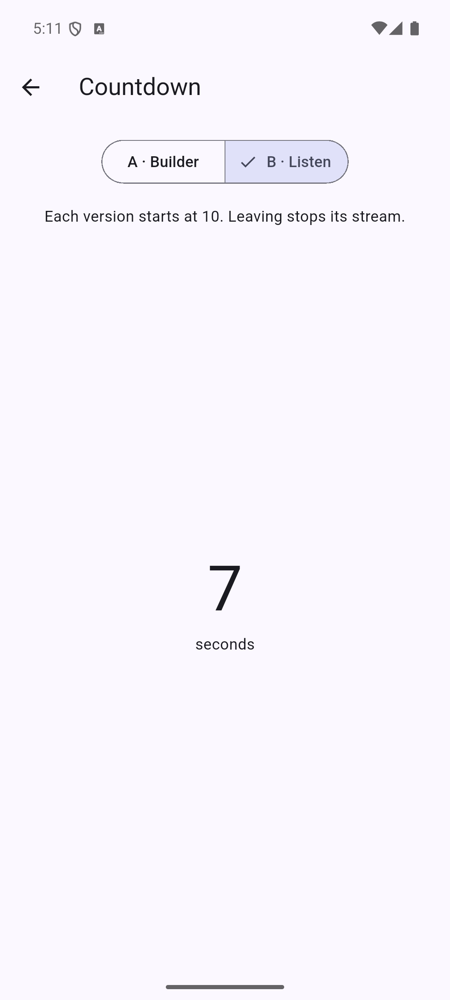

# Students Async

Practice 10: four asynchronous UI states, cached Futures, stream cancellation and awaited saves. All data comes from a local fake API; no network connection or account is needed.

## Run

Open this directory in Android Studio, choose Pixel 7, then run lib/main.dart.

    flutter pub get
    flutter run

## Try it

- **By hand**: loading lasts two seconds. Tap Reload twice after the first load to reach request 3 and the error view; Retry recovers.
- **Empty response** on Home: either student screen displays “No students yet” after loading (every third request still fails).
- **FutureBuilder**: toggle Compact rows repeatedly; the console request counter stays unchanged. Reload makes a new request.
- **Countdown**: choose A · Builder or B · Listen. Each starts at 10; navigate Back mid-count and tick logs stop.
- **Save**: the first save closes By hand. Reopen and save again; the server rejection appears in a SnackBar and the screen remains open. Rapid double tapping cannot submit twice.

Counters are shared between student routes for the selected fake server and reset on a fresh application launch. State and data are in memory.

## Verification

    flutter analyze
    flutter test
    dart format --output=none --set-exit-if-changed .

See [NOTES.md](NOTES.md) for event-order observations, lifecycle errors and countdown experiments. The test suite covers all four loading states, retry, ten compact toggles, double Save, navigation during pending work and both countdown lifecycles.

