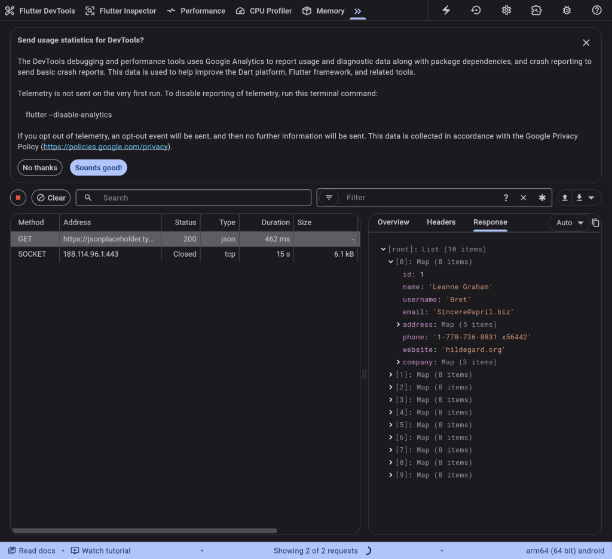
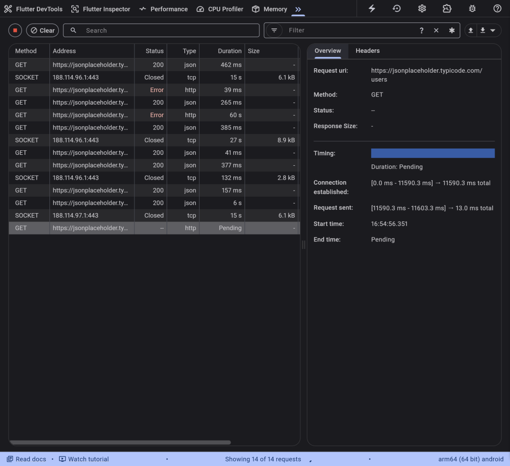

# Users API

Practice 11: real HTTP networking against `jsonplaceholder.typicode.com` with strict JSON models, a repository boundary, `ApiClient` timeout/exception mapping, `ChangeNotifier` state, exhaustive sealed-error UI switching, and a POST form.

## Run

Open this directory (`practice_11/users_api`, containing `pubspec.yaml`) in Android Studio, select **Pixel 7**, and run `lib/main.dart`:

```bash
flutter pub get
flutter run
```

## Verification

```bash
flutter analyze
flutter test
dart format --output=none --set-exit-if-changed .
grep -rn "package:http" lib/
```

See [NOTES.md](NOTES.md) for Level 1 Postman/curl tables, error-mapping notes, and the two "no network" timings.



